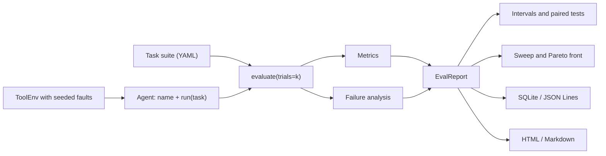

# Agent Reliability Lab

**A crash-test lab for AI agents.** Break tools on purpose in a repeatable
way, run each agent several times, explain *why* every failed run failed, and
pick the cheapest setup that stays reliable.

Most agent benchmarks report one number: did the agent finish the task? That
number hides the reasons. One agent skips a tool it needed, another calls a
tool it was never given, a third repeats the same call after the answer came
back, a fourth gives up after a single timeout. Agent Reliability Lab
(`relai`) records the whole trajectory of every run, scores it, measures cost,
latency, recovery, and step use, and classifies the failure with evidence, so
two agents can be compared on the reasons as well as the score.

```
$ relai run reliability --agent naive --agent retry:1 --agent retry:3 --trials 5 --timeout-rate 0.3
variant  success  95% CI        pass^k  consistent  cost     latency  recovery  horizon
-------  -------  ------------  ------  ----------  -------  -------  --------  -------
retry:3  1.00     [1.00, 1.00]  1.00    1.00        $0.0030  1116ms   1.00      8.8
retry:1  0.77     [0.67, 0.88]  0.33    0.33        $0.0025  947ms    0.79      7.2
naive    0.58     [0.38, 0.77]  0.25    0.33        $0.0016  543ms    0.58      5.0

failure modes (retry:3): {'horizon': 12}
failure modes (retry:1): {'recovery': 14, 'horizon': 2}
failure modes (naive): {'recovery': 25}

retry:3 vs retry:1 on 60 paired runs: retry:3 alone passed 14, retry:1 alone passed 0; McNemar p = 0.0001 (significant)
```

Read it like this: with 30% of tool calls timing out, an agent that never
retries solves 58% of runs, and only 25% of tasks are solved in all five
trials (pass^5). Three retries bring success to 100% at nearly twice the cost
and latency. They also blow the step budget on 12 long tasks, which the lab
flags as a horizon failure even though the answers were right.

## What it does

| Objective | What the lab provides |
| --- | --- |
| Evaluate agents | success, correctness, cost, latency, tokens, tool calls, recovery rate, steps; pass@k, pass^k, and consistency over repeated trials |
| Explain failures | five failure modes with evidence (planning, tool misuse, context, recovery, horizon); unmatched failures stay *unclassified* |
| Measure recovery | seeded fault injection (timeouts, outages, fail-first-N) that every variant meets identically |
| Compare fairly | same tasks, scorer, trials, and fault schedule for every variant; Wilson and bootstrap intervals; exact McNemar paired test |
| Optimize | grid sweeps over agent settings, Pareto front over success, cost, and latency, cheapest setting that meets a target |
| Keep results | SQLite store and JSON Lines export; standalone HTML and Markdown reports |

## Install

```bash
python -m venv .venv
source .venv/bin/activate
pip install -e ".[dev]"
```

Python 3.11 or newer. Runtime dependencies are Pydantic and PyYAML only. The
offline agents and every test run without a GPU, a network, or an API key.

## Quick tour

```bash
relai demo                                   # scripted brittle vs resilient agent
relai suites                                 # built-in task suites
relai run demo                               # naive vs retrying agent on the demo suite
relai run reliability --trials 5 --timeout-rate 0.3 --html report.html --store runs.db
relai stress reliability --agent naive --agent retry:1 --agent retry:3 --trials 5
relai sweep reliability --param max_retries=0,1,2,3 --timeout-rate 0.3 --trials 5
relai selfcheck --trials 5                   # does the classifier find planted defects?
relai report runs.db --list                  # stored experiments
relai report runs.db --html report.html      # re-render the latest one
```

Every command accepts `--json`; `run`, `sweep`, and `report` also write
`--html` and `--markdown`, and `run` and `sweep` save with `--store`.

### Stress test: how fast does success fall?

```
$ relai stress reliability --agent naive --agent retry:1 --agent retry:3 --trials 5
success rate as tool timeouts increase
agent \ timeout rate  0     0.1   0.2   0.3   0.4   0.5
--------------------  ----  ----  ----  ----  ----  ----
naive                 1.00  0.87  0.70  0.58  0.45  0.38
retry:1               1.00  1.00  0.92  0.77  0.68  0.53
retry:3               1.00  1.00  1.00  1.00  0.92  0.82
```

### Sweep: the cheapest reliable setting

```
$ relai sweep reliability --param max_retries=0,1,2,3,4 --timeout-rate 0.3 --trials 5
...
Pareto front (success, cost, latency): max_retries=4, max_retries=3, max_retries=2, max_retries=1, max_retries=0
Recommended: max_retries=2 (success 0.98, $0.0030 and 1116 ms per run), the cheapest setting with success >= 0.90.
```

### Self-check: is the classifier right?

Each baseline agent carries one planted defect, so the correct diagnosis is
known in advance. The self-check runs them under the same faults and counts
which root cause the classifier reports.

```
$ relai selfcheck --trials 5
diagnosed root cause per agent, reliability suite, timeout rate 0.3
agent     planted      planning  tool_misuse  context  recovery  horizon  unclassified  none  agreement
--------  -----------  --------  -----------  -------  --------  -------  ------------  ----  ---------
naive     recovery     0         0            0        25        0        0             35    1.00
retry     (control)    0         0            0        1         11       0             48    0.80
guessing  planning     55        0            0        0         0        0             5     1.00
looping   context      0         0            55       0         0        0             5     1.00
careless  tool_misuse  0         60           0        0         0        0             0     1.00

precision by mode: context 1.00, planning 1.00, recovery 1.00, tool_misuse 1.00
```

"none" counts runs where the defect never surfaced, for example a naive agent
that happened to meet no timeout. The control agent's 11 horizon diagnoses
are real step-budget overruns caused by its retries.

## Plug in your own agent

An agent is anything with a `name` and `run(task) -> Trajectory`. Route tool
calls through the suite's environment and injected faults reach your agent
exactly as they reach the baselines:

```python
from relai import FaultPolicy, Variant, load_suite, make_baseline, run_experiment, to_html


class MyAgent:
    name = "mine"

    def __init__(self, env):
        self.env = env

    def run(self, task):
        rec = self.env.recorder(task)          # records every step
        rec.plan("look it up")
        result = rec.call("order_status", {"order": "O-88121"})
        if not result.ok:                      # injected timeout or outage
            rec.recovery("retry once")
            result = rec.call("order_status", {"order": "O-88121"})
        return rec.final(result.output if result.ok else "unknown")


suite = load_suite("reliability")
env = suite.env(FaultPolicy(timeout_rate=0.3))
experiment = run_experiment(
    suite.tasks[:1],
    [Variant("mine", MyAgent(env)), Variant("naive", make_baseline("naive", env))],
    trials=5,
)
open("report.html", "w").write(to_html(experiment))
```

From the CLI, point `--agent` at any factory that takes a `ToolEnv`:

```bash
relai run reliability --agent examples.custom_agent:make_agent --agent retry:2 --timeout-rate 0.3
```

### Live models

`relai.adapters.OpenAICompatAgent` runs a tool-calling loop against any
OpenAI-compatible endpoint (OpenAI, Groq, Together, vLLM, or a local Ollama
server) and records tokens, cost, and latency per step:

```bash
OPENAI_API_KEY=sk-... RELAI_MODEL=gpt-4o-mini python examples/live_llm_agent.py
OPENAI_BASE_URL=http://localhost:11434/v1 RELAI_MODEL=qwen2.5:7b python examples/live_llm_agent.py
```

## How it works



- A **trajectory** is the ordered list of steps in one run: `plan`,
  `tool_call`, `observation`, `error`, `recovery`, `final`, each with
  optional latency, tokens, and cost.
- **Faults** depend only on (seed, task, trial, tool, call number), never on
  the agent, so the third call to `weather` in trial 2 times out for every
  variant. That turns comparisons into paired experiments.
- **Metrics and failure analysis only read trajectories.** They never call
  agents, so scoring is reproducible and testable.
- **pass^k** is the chance that all k attempts at a task succeed, estimated
  as C(c, k) / C(n, k) from c successes in n trials. It measures dependability
  where pass@k measures capability.

See [documentation/architecture.md](documentation/architecture.md) for the
module map and data flow, and
[documentation/failure-taxonomy.md](documentation/failure-taxonomy.md) for
the exact rule behind each failure mode.

## Writing a suite

```yaml
name: my-suite
scorer: normalized            # exact, contains, normalized, numeric, regex
tools:
  order_status:
    arg: order
    cost_usd: 0.001
    latency_ms: 100
    responses: {O-1: shipped}
faults: {timeout_rate: 0.2}   # default faults; CLI flags override
tasks:
  - id: status
    prompt: What is the status of order O-1?
    expected: shipped
    allowed_tools: [order_status]
    tags: [requires_tools]
    max_steps: 8              # longer runs are flagged as horizon failures
    guess: processing         # what the guessing baseline answers
    solution:                 # reference plan the baselines follow
      - {tool: order_status, args: {order: O-1}}
```

Run it with `relai run path/to/my-suite.yaml`. In `solution`, `"{0}"` inserts
the output of the first call, `"{1}"` the second, and so on.

## Project layout

```
src/relai/
  types.py        Task, Step, Trajectory, Score, RunMetrics, FailureReport, RunResult
  agents.py       Agent protocol, FunctionAgent, ScriptedAgent
  env.py          ToolEnv, FaultPolicy, Recorder, lookup and calculator tools
  harness.py      evaluate(): trials, timing, scoring, pass@k, pass^k
  metrics.py      scorers and metric derivation
  analysis.py     failure-mode classification with evidence
  experiment.py   controlled multi-variant runs and stress tests
  stats.py        Wilson and bootstrap intervals, exact McNemar test
  optimize.py     grid sweeps, Pareto front, recommendation
  suite.py        YAML/JSON suites; suites/ holds the built-in ones
  baselines.py    offline reference agents with planted defects
  selfcheck.py    classifier check against planted defects
  store.py        SQLite store and JSON Lines
  report.py       HTML and Markdown reports
  adapters/       OpenAI-compatible tool-calling agent
  cli.py          the relai command
tests/            81 tests, one file per module
examples/         runnable scripts
documentation/    architecture and failure taxonomy
academic/         progress review pack: research paper, slides, report, diagrams
```

## Development

```bash
pytest
ruff check src tests examples
```

CI runs both on Python 3.11, 3.12, and 3.13. A new failure mode is accepted
only with a trajectory fixture in `tests/test_analysis.py` that shows when it
fires and when it must stay silent.

## Team

Capstone project, Department of Computer Science and Engineering, Noida
Institute of Engineering and Technology, Greater Noida, under the supervision
of Mr. Pradeep Kumar.

- Suryansh Singh (team lead): architecture, harness, environment, store, CLI
- Simran Kumari: metrics, failure analysis, statistics, optimization
- Tanishka Sahu: task suites, baseline agents, reports, tests, examples

See [guide.md](guide.md) for the full work split and presentation guide.

## License

MIT
