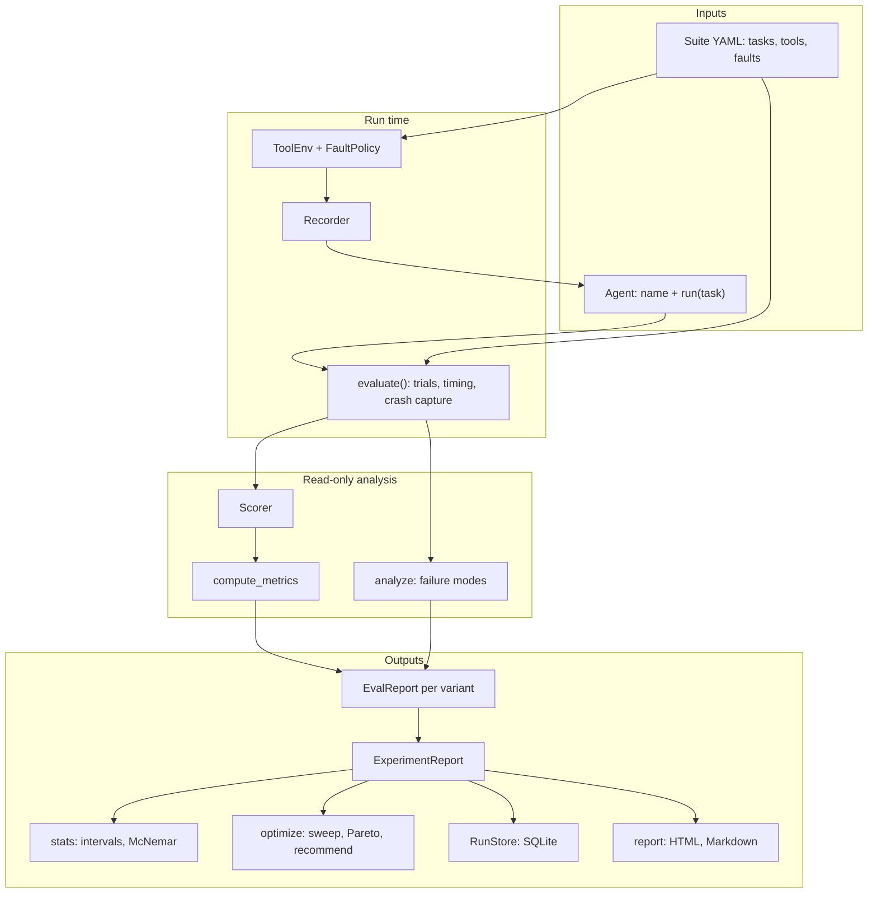
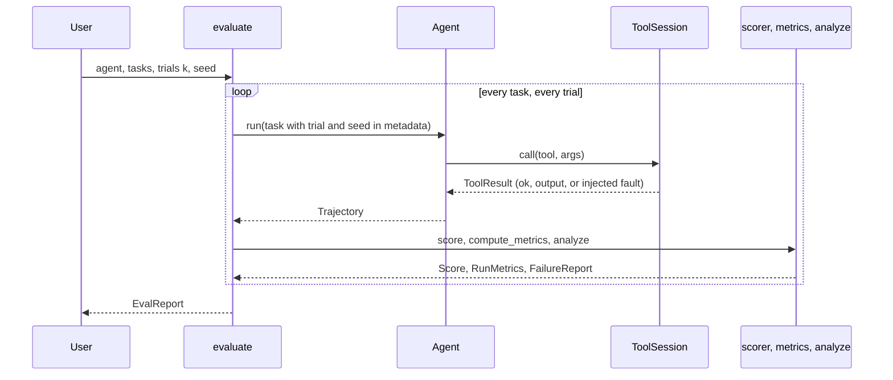
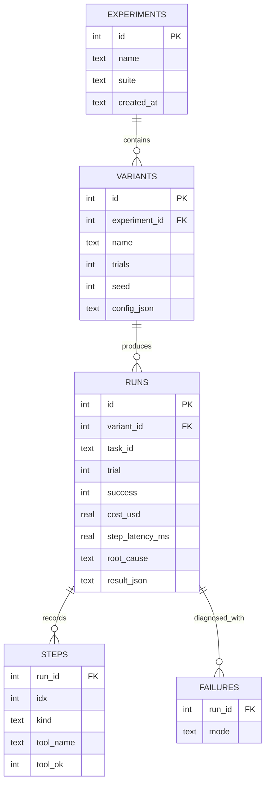

# Architecture

Agent Reliability Lab is a batch evaluation pipeline. Data flows one way:
tasks and an agent go in, trajectories come out, and everything after that
only reads trajectories.

## Design rules

1. **The agent seam stays small.** An agent is anything with `name` and
   `run(task) -> Trajectory`. Model backends, orchestrators, memory systems,
   and hand-written policies adapt to that seam; the harness never changes
   for them.
2. **Analysis never calls agents.** Scorers, metrics, the failure classifier,
   statistics, and reports read finished trajectories only. That keeps every
   number reproducible from stored data.
3. **Faults are part of the experiment, not the agent.** A fault depends on
   (seed, task id, trial, tool name, call number). Two variants that make the
   same calls meet the same faults, so their runs can be paired.
4. **Unknown stays unknown.** A failed run that matches no rule is marked
   unclassified. The taxonomy grows only when a fixture pins the new rule.
5. **Crashes are data.** An exception inside `run` becomes a failed run with
   an error step instead of stopping the experiment.

## Modules

| Module | Responsibility | Key names |
| --- | --- | --- |
| `types.py` | Domain objects shared by every pass | `Task`, `Step`, `Trajectory`, `Score`, `RunMetrics`, `FailureReport`, `RunResult` |
| `agents.py` | The agent seam and two adapters | `Agent`, `FunctionAgent`, `ScriptedAgent` |
| `env.py` | Tools, fault injection, step recording | `ToolEnv`, `FaultPolicy`, `ToolSession`, `Recorder`, `lookup_tool`, `calculator_tool` |
| `harness.py` | Run tasks for k trials, time them, score, classify | `evaluate`, `EvalReport` (`pass_at_k`, `pass_hat_k`, `consistency`) |
| `metrics.py` | Scorers and per-run metrics | `exact_match`, `normalized_match`, `numeric_match`, `regex_match`, `compute_metrics` |
| `analysis.py` | Failure classification with evidence | `analyze`, `error_episodes` |
| `experiment.py` | Same tasks, scorer, trials, seed for every variant | `Variant`, `run_experiment`, `stress_test`, `ExperimentReport` |
| `stats.py` | Uncertainty and significance | `wilson_interval`, `bootstrap_ci`, `success_ci`, `compare`, `mcnemar_exact` |
| `optimize.py` | Configuration search | `grid`, `sweep`, `pareto_front`, `recommend` |
| `suite.py` | Declarative suites | `Suite`, `ToolSpec`, `load_suite`, `save_suite` |
| `baselines.py` | Offline agents with known behaviour | `NaiveToolAgent`, `RetryAgent`, `GuessingAgent`, `LoopingAgent`, `CarelessAgent` |
| `selfcheck.py` | Classifier check against planted defects | `planted_defect_check`, `DefectCheck` |
| `store.py` | Persistence | `RunStore`, `write_jsonl`, `read_jsonl` |
| `report.py` | Rendering | `to_html`, `to_markdown`, `summary_rows` |
| `adapters/` | Live model backends | `OpenAICompatAgent` |
| `cli.py` | The `relai` command | `demo`, `suites`, `run`, `sweep`, `stress`, `selfcheck`, `report` |

## One evaluation, step by step

The trial index and seed reach the agent through `task.metadata`
(`relai.trial`, `relai.seed`), so the protocol needs no extra arguments. The
harness scores against the original task, not the copy it handed to the
agent.

## Data model

The SQLite store (`store.py`) mirrors the in-memory objects:

`runs.result_json` keeps the full `RunResult`, so loading an experiment is
lossless. The `steps` and `failures` tables exist for SQL queries such as
failure counts per variant.

## Metrics

For one run with steps \(s_1, \dots, s_m\):

- cost, step latency, and tokens are sums over steps; wall latency is timed
  around `run`;
- recovery rate is recovered errors divided by errors (1.0 when there are no
  errors). An error is recovered when a later call of the same tool works, or
  the run ends with a correct answer;
- horizon is \(m\), the number of steps.

For a task with \(c\) successes in \(n\) trials:

- pass@k \(= 1 - \binom{n-c}{k} / \binom{n}{k}\), the chance that at least
  one of k attempts succeeds;
- pass^k \(= \binom{c}{k} / \binom{n}{k}\), the chance that all k succeed;
- a task is consistent when its trials all pass or all fail.

Report values are means over tasks. Ranking orders variants by success rate,
then cost, then recorded latency, then wall latency in whole milliseconds,
then name.

## Statistics

- One trial per task: Wilson score interval over runs.
- Several trials: runs of one task are correlated, so the interval resamples
  whole tasks (a cluster bootstrap, seeded).
- Two variants: runs are paired by (task, trial), and the exact McNemar test
  uses only the pairs where exactly one variant succeeded.

## Optimization

`sweep` builds one variant per point of a parameter grid. `pareto_front`
keeps variants that no other variant matches or beats on success, cost, and
latency while beating on at least one. `recommend` returns the cheapest
variant, then the fastest, whose success meets a target.
